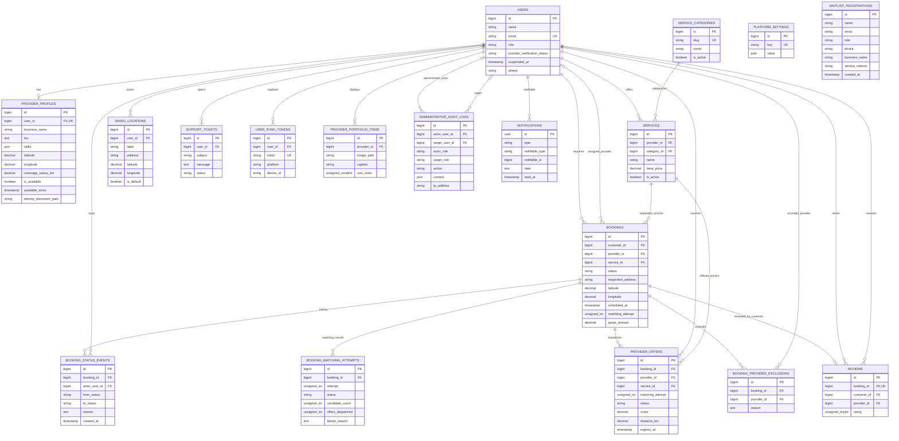

# Neybor data model

The schema is implemented by `database/migrations`. MySQL is the production database; tests use SQLite. The ER diagram below covers application-domain tables only. Framework tables (`cache`, `jobs`, `job_batches`, `failed_jobs`, and `personal_access_tokens`) are intentionally omitted from the domain diagram.

## Tables and constraints

| Table | Purpose and important constraints |
| --- | --- |
| `users` | Authentication identity, email verification, role, provider-approval status, suspension metadata, and phone. Roles and verification states are application enums stored as strings. Administrator role is not self-assignable at registration. |
| `provider_profiles` | One-to-one provider professional, location, coverage, availability, and identity-document fields. Unique `user_id`; location and availability have a composite query index. Identity files use the configured private identity disk. |
| `service_categories` | Catalogue categories; unique slug and active flag. |
| `services` | Provider-owned offers in one category, with description and optional price/unit. Provider and category FKs; category/active index. A provider can publish multiple services. |
| `bookings` | The customer service request and booking lifecycle in one row. Customer and service are required; assigned provider is nullable until offer acceptance and is cleared on provider cancellation/rematching. Address and precise coordinates are booking-private. `scheduled_at` is nullable; matching attempt metadata, availability snapshot, completion timestamp, and final quote are persisted here. |
| `provider_offers` | Individual provider dispatches and responses, including attempt, expiry, score, and distance. Unique `(booking_id, matching_attempt, provider_id)` prevents duplicate offers to a provider in one attempt. |
| `booking_matching_attempts` | Auditable per-request dispatch rounds, counts, result state, and failure reason. Unique `(booking_id, attempt)`. |
| `booking_status_events` | Append-only transition history with optional actor and reason. Indexed by booking and creation time; a new event triggers after-commit realtime and notification handling. |
| `booking_provider_exclusions` | Prevents a provider who cancelled a booking from being offered that same request again. Unique `(booking_id, provider_id)`. |
| `reviews` | One review per booking (`booking_id` unique), with customer, provider, rating, and optional comment. Provider/date index supports provider review summaries. |
| `saved_locations` | User-owned addresses and coordinates; indexed by `(user_id, is_default)`. |
| `provider_portfolio_items` | Provider-owned public portfolio media and display order. |
| `support_tickets` | User-owned support requests with a simple status. |
| `user_push_tokens` | Device/platform registration; token is globally unique to avoid sending duplicate pushes for one installation. |
| `notifications` | Laravel polymorphic in-app notifications with UUID IDs and indexed unread timestamp. Stable notification IDs make database delivery idempotent on queue retries. |
| `administrative_audit_logs` | Administrative action, actor/target snapshots, context, IP, and user agent. Indexed by action/date and target/date; records are not updated by application workflows. |
| `platform_settings` | One JSON document per unique setting key. `marketplace` stores non-secret pricing/gateway preferences, blank policy values, and an invariant disabled-payment flag. Gateway selections are not connected to checkout. |
| `waitlist_registrations` | Pre-launch website registrations, with customer/provider audience, normalized email, optional phone and service-interest fields. Unique `(email, role)` prevents duplicate signups while permitting one customer and one provider entry for the same address. No user account is created. |

Core foreign keys cascade when an owning account/request is deleted, except bookings retain referential integrity to the selected service/category (service category deletion is restricted, and service deletion is restricted while referenced); optional provider/actor references are nullable where the workflow requires it. Database-level uniqueness guards one review per booking, one provider profile per user, one offer per provider per attempt, and one exclusion per booking/provider. Booking state transitions and matching acceptance also use transactions and row locks.

## Query and location design

Provider and customer coordinates use `DECIMAL(10,7)` and coverage uses a radius in kilometers. The matcher narrows candidates with an indexed availability/latitude/longitude bounding box, then applies exact Haversine distance and provider coverage checks. It does not depend on MySQL GIS extensions. The booking/service/provider status and offer-expiry indexes support active-job lookup and queue dispatch. If catalogue scale or geographic density grows significantly, evaluate a spatial index or dedicated geospatial search after measuring the current query plan.

## Deliberate scope boundaries

The current release has no standalone `service_requests` table: `bookings` represents a customer request from initial matching through completion. Availability is current provider state on `provider_profiles`; there is no weekly schedule or time-slot calendar table yet. Provider-service association is represented directly by `services.provider_id`, not a redundant `provider_services` join table. Service coverage is represented by a provider center and radius, not polygons or a separate service-area table.

There are no payment/transaction, conversation/message, dispute, or verification-submission tables in the shipped schema. Identity-document metadata is on `provider_profiles`; the actual file is stored on the configured private storage disk. These features require their own requirements, retention policy, and access controls before schema/API work begins.

The admin payment preferences are not a payment ledger. Pricing selection, gateway selection, commission/cancellation/refund values are configuration records only; marketplace checkout and payout logic do not consume them. Payment collection is disabled until provider integrations and the relevant product rules have been implemented and tested.

## Migrations and sample data

Configure `.env`, then run `php artisan migrate`. `DatabaseSeeder` invokes `DemoMarketplaceSeeder` only in local environments; the demo seeder refuses to run in production. It creates sample catalogue/provider data with a placeholder identity-document path and no usable demo password. Do not treat the sample provider as a verified real person or use the placeholder as a verification decision.
